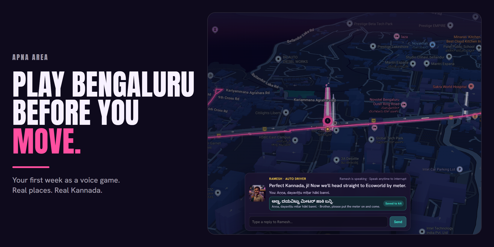
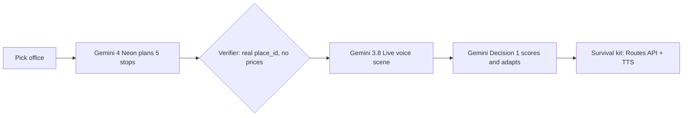

<div align="center">



# Apna Area

**Play your first week in Bengaluru before you move.**

A voice-first game on Bengaluru's Outer Ring Road. Pick your office, and Gemini builds your Monday to Friday out of real places. You talk your way through each day with live voice characters, pick up polite Kannada, and leave with a survival kit.

[**Try it live**](https://apna-area-481049877093.asia-south1.run.app/?demo=1) · [Architecture](docs/ARCHITECTURE_OVERVIEW.md) · [Models](docs/MODELS.md) · [Build history](docs/BUILD_HISTORY.md)

No login. No API key. Under 3 minutes.

</div>

---

## Why

Moving to a new city is a week of small, scary firsts: the auto ride, the breakfast counter, the PG visit, the bus stop. Maps tell you where things are. They don't let you practise.

Apna Area is built for someone like Ananya: 24, moving from Lucknow to a Bellandur tech park, speaks Hindi and English, no Kannada. She plays her first week out loud, then gets real Monday commute times and the phrases she actually spoke.

## Features

| | Feature | What you get |
|---|---|---|
| 🗺️ | **Pick your office** | 12 verified ORR tech parks. `Ctrl+K` search or one-click chips. Dusk camera tour on first load. |
| 🧭 | **Your week, planned** | Gemini 4 Neon builds 5 stops (Mon to Fri) from 121 verified Google Maps places, streamed live. |
| ✅ | **Nothing invented** | Every stop shows its Google Maps `place_id`. A server verifier blocks unknown places and made-up prices. |
| 🎙️ | **Talk to the city** | Live voice characters (Gemini 3.8 Live) in English, Hindi or Hinglish. Type instead if you have no mic. |
| 🗣️ | **Speak Kannada** | One polite survival phrase per stop. Say it out loud and it lands in your phrasebook. |
| 📈 | **Adapts to you** | Gemini Decision 1 scores each turn in ~450 ms and tunes the next stop. One tap overrides the pace. |
| 🧳 | **Survival kit** | Monday 09:00 and 18:30 commutes (Routes API), Kannada audio replay (Gemini 3.8 Flash TTS), move-in checklist. |
| 🌆 | **3D Neon Dusk** | Optional 3D map with light pillars, live ORR traffic streaks, Sky-Drop camera and a radar minimap. |
| 🔒 | **You stay in control** | Every external link or download asks first. No location access. Voice is never stored. |

## Try it in 3 steps

1. Open the [live app](https://apna-area-481049877093.asia-south1.run.app/?demo=1), press `Esc` to skip the tour, pick **RMZ Ecoworld**, click **Build my first week**.
2. Click **Talk with Ramesh**. Speak (or **Type instead**) and say the Kannada line on screen.
3. Open **Survival Kit** to see real commutes and replay your phrase.

## How it works



| Job | Model |
|---|---|
| Plan the week | `gemini-4-neon` (fallback `gemini-4-hydrogen`) |
| Voice characters | `gemini-3.8-live` with server-locked ephemeral tokens |
| Score and adapt | `gemini-decision-1` |
| Area notes, phrase audio | `gemini-3.5-flash-lite`, `gemini-3.8-flash-tts` |
| Music, portraits (build time) | `lyria-3-clip-preview`, `gemini-nano-banana-2.1` |

All model IDs live in [`shared/src/config.ts`](shared/src/config.ts). Full prompts and schemas: [`docs/MODELS.md`](docs/MODELS.md).

**Stack:** React 19 + Vite, Fastify on Node 22, TypeScript monorepo, Google Maps Platform, Three.js (lazy), Cloud Run. No database.

## Run it locally

You need Node.js 22+, a [Gemini API key](https://aistudio.google.com/apikey), and Google Maps Platform keys (Maps JavaScript API, Places API (New), Routes API).

```bash
git clone https://github.com/bhagyarana/Apna-Area.git
cd Apna-Area
cp .env.example .env.local    # add your keys
npm install
npm run dev                   # API on :8080, web on :5173
```

| Variable | Used for |
|---|---|
| `GEMINI_API_KEY` | All Gemini calls (server only) |
| `MAPS_BROWSER_KEY` | Map rendering in the browser (restrict by referrer) |
| `MAPS_SERVER_KEY` | Places and Routes calls (server only) |

### Scripts

| Command | What it does |
|---|---|
| `npm run check` | Typecheck, lint, unit tests |
| `npm run build` | Production build |
| `npm run test:smoke` | Playwright end-to-end specs |
| `npm start` | Serve the production build |

### Deploy to Cloud Run

```bash
gcloud run deploy apna-area --source . --region asia-south1 \
  --set-secrets GEMINI_API_KEY=gemini-api-key:latest,MAPS_BROWSER_KEY=maps-browser-key:latest,MAPS_SERVER_KEY=maps-server-key:latest \
  --memory 1Gi --cpu 1 --min-instances 1 --max-instances 3 --timeout 3600
```

## Project structure

```
web/      React app (map, HUD, voice scene, survival kit)
server/   Fastify API (director, live tokens, scoring, kit, TTS)
shared/   Types and config.ts (model IDs, flags, limits)
data/     Verified ORR places, corridor, Kannada phrases
scripts/  One-off builders (places, corridor, music, portraits)
e2e/      Playwright specs
docs/     Architecture, models, decisions, build history
video/    Source for the demo video (Remotion)
```

## Contributing

Issues and PRs are welcome. A few house rules keep the game honest:

- Only reference places in [`data/orr/places.json`](data/orr/places.json). Never invent prices or fares.
- Model IDs only from `shared/src/config.ts`. Keys never reach the browser.
- Work on a `phase/<name>` branch and run `npm run check` before opening a PR.
- Plain, friendly copy. No em dashes in UI text.

Good first ideas: a new corridor (Whitefield, Electronic City), more Kannada phrases with native-speaker review, or another comfort language.

## Docs

[Architecture](docs/ARCHITECTURE.md) · [Models](docs/MODELS.md) · [Data](docs/DATA.md) · [Decisions](docs/DECISIONS.md) · [Testing](docs/TESTING.md) · [Demo script](docs/DEMO.md) · [Build history](docs/BUILD_HISTORY.md)

## Credits

Map data © Google. Music generated with Lyria 3, character portraits with Nano Banana ([credits](web/public/audio/credits.json)). UI behaviour by [`@ui-sdk/react`](https://ui-sdk.dev), icons by [Hugeicons](https://hugeicons.com), fonts Anton, Hanken Grotesk and Noto Sans (SIL OFL). All characters are fictional.
