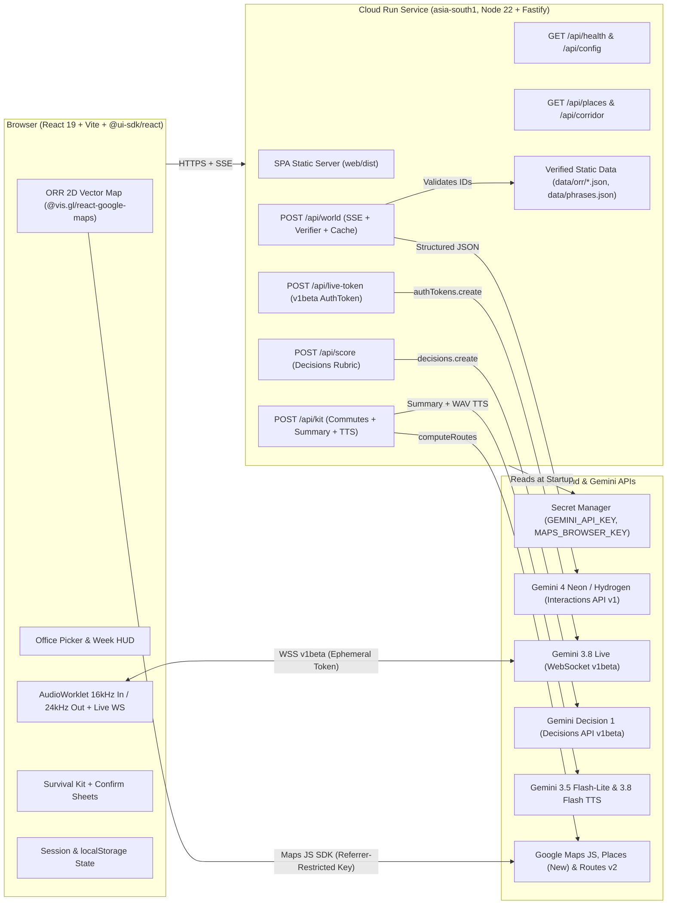
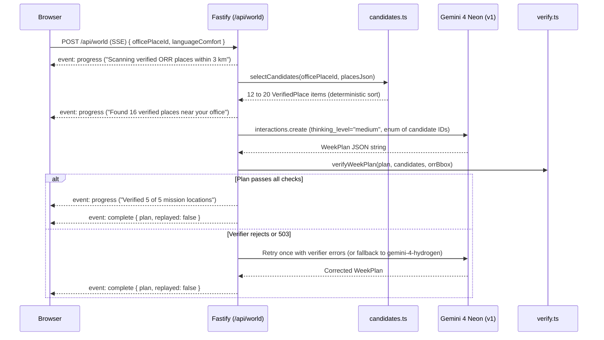
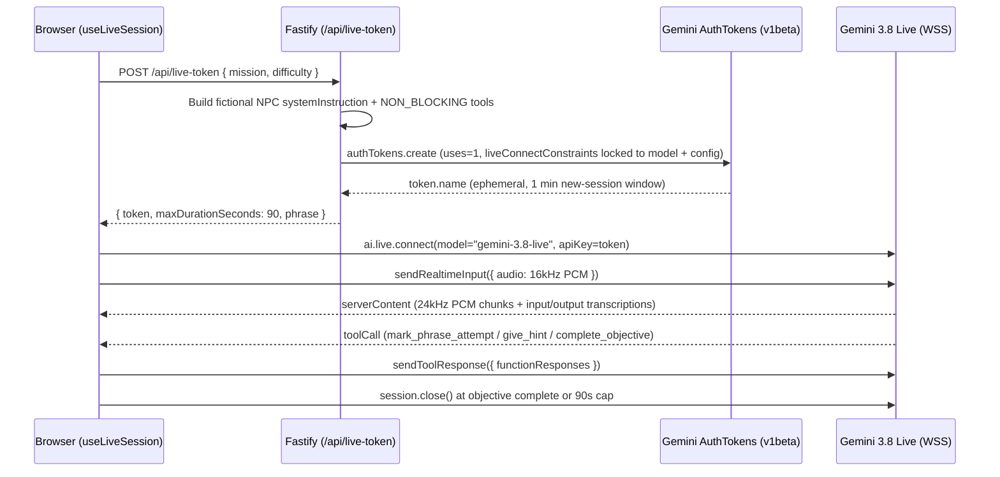
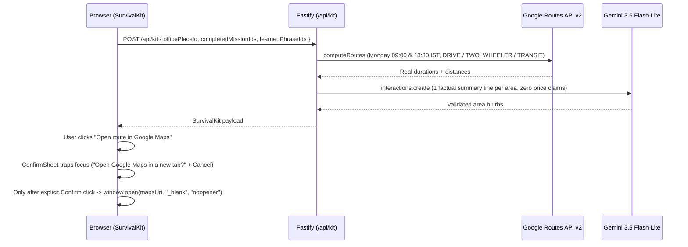

# System Architecture

## 1. High-Level System Diagram



## 2. Monorepo Folder Structure

```text
Apna-Area/
├── AGENTS.md
├── PROJECT_BRIEF.md
├── Design.md
├── Dockerfile
├── package.json                  # npm workspaces: shared, server, web
├── playwright.live.config.ts
├── vitest.config.ts
├── .agents/
│   ├── rules/                    # engineering, design, gemini-models, security-and-control, context-hygiene
│   └── skills/                   # ship-phase, handoff
├── shared/
│   ├── package.json
│   ├── config.ts                 # MODEL_IDS, ORR_BBOX, ENABLED_LANGUAGES, timeouts, rate limits
│   ├── types.ts                  # Zod schemas + inferred TypeScript types shared by server & web
│   ├── logger.ts                 # Cloud Logging structured JSON logger
│   └── game/                     # Pure functions: xpFor, starsFor, nextDifficulty
├── data/
│   ├── phrases.json              # 30 Kannada survival phrases keyed by PhraseSituation (P3c)
│   └── orr/
│       ├── places.json           # Verified Places API (New) dataset with place_id & verifiedAt
│       └── corridor.geojson      # Decoded ORR route LineString (Marathahalli to Silk Board)
├── scripts/
│   ├── verify-places.ts          # Build-time Places API (New) Text Search + bbox filter
│   ├── build-corridor.ts         # Build-time Routes API corridor GeoJSON builder
│   ├── generate-portraits.ts     # Build-time Nano Banana 2.1 NPC portraits -> web/public/art/npcs/
│   └── generate-music.ts         # Build-time Lyria 30s mood loops -> web/public/audio/
├── server/
│   ├── package.json
│   ├── index.ts                  # Fastify bootstrap, rate-limit, requestId logging, SPA static serve
│   ├── routes/                   # health.ts, config.ts, world.ts, liveToken.ts, score.ts, kit.ts
│   ├── world/                    # candidates.ts, director.ts, schema.ts, verify.ts, cache.ts
│   ├── live/                     # persona.ts, token.ts, tools.ts
│   ├── score/                    # decide.ts
│   └── kit/                      # commute.ts, summary.ts, tts.ts
├── web/
│   ├── package.json
│   ├── index.html
│   ├── public/
│   │   ├── art/npcs/             # Pre-generated fictional NPC portraits
│   │   └── audio/                # Pre-generated 30s Lyria instrumental loops + credits.json
│   └── src/
│       ├── main.tsx
│       ├── App.tsx
│       ├── styles/tokens.css     # Design.md CSS custom properties
│       ├── map/                  # OrrMap.tsx, CorridorLayer.tsx, CameraTour.tsx, mapStyle.ts
│       ├── picker/               # OfficePicker.tsx, TunePopover.tsx
│       ├── hud/                  # WeekProgressBar.tsx, MissionCard.tsx, XpCounter.tsx, ProgressChips.tsx
│       ├── live/                 # useLiveSession.ts, pcmWorklet.ts, MissionDialog.tsx, Captions.tsx
│       ├── score/                # MissionResultCard.tsx, WhyChangedDisclosure.tsx
│       ├── kit/                  # SurvivalKit.tsx, CommuteCard.tsx, PhrasebookCard.tsx, ConfirmSheet.tsx
│       └── audio/                # ambient.ts
└── docs/                         # PRD, ARCHITECTURE, MODELS, DATA, TASKS, TESTING, DEMO, RISKS, DECISIONS, HANDOFF
```

## 3. HTTP & SSE API Contracts

All API endpoints return JSON matching `ApiResult<T> = { ok: true; data: T; requestId: string } | { ok: false; error: { code: string; message: string; retryable: boolean }; requestId: string }`, except `POST /api/world` when `Accept: text/event-stream` is sent. Rate limit: 30 requests per minute per IP across `/api/*` (`POST /api/live-token` capped at 8 per minute per IP).

| Method & Path | Request Schema (Zod) | Response Payload (`data`) | Timeout & Cache |
|---|---|---|---|
| `GET /api/health` | none | `{ status: "ok", version: string, commit: string, builtAt: string, upstreams: { placesLoaded: number, geminiConfigured: boolean, mapsConfigured: boolean } }` | 2 s, no cache |
| `GET /api/config` | none | `{ mapsBrowserKey: string, mapId: string, enabledLanguages: LanguageCode[], orrBbox: BoundingBox, featureFlags: FeatureFlags }` | 2 s, 60 s memory |
| `GET /api/places` | `?category=` optional | `{ places: VerifiedPlace[], corridor: GeoJSONLineString, verifiedAt: string }` | 2 s, immutable in-process |
| `POST /api/world` | `{ officePlaceId: string, languageComfort: "en" \| "hi" \| "en_hi", budgetBand: "15_20k" \| "20_30k" \| "30k_plus" }` | SSE events: `progress` (`{ step, detail, count? }`), `complete` (`{ plan: WeekPlan, replayed: boolean }`), `error` (`{ code, message }`) | 20 s total, cached in LRU by `officePlaceId + languageComfort` |
| `POST /api/live-token` | `{ mission: Mission, officeName: string, placeName: string, difficulty: DifficultyState, activeLanguage: LanguageCode }` | `{ token: string, expireTime: string, model: string, maxDurationSeconds: 90, phrase?: SurvivalPhrase }` | 6 s, never cached (`uses: 1`) |
| `POST /api/score` | `{ missionId: string, objective: string, transcript: TranscriptTurn[], activePhrase?: SurvivalPhrase, currentDifficulty: DifficultyState }` | `{ answers: RubricAnswers, xpEarned: number, stars: 1 \| 2 \| 3, nextDifficulty: DifficultyState, usedSafeDefault: boolean, summaryLine: string }` | 5 s, idempotent per `missionId + transcriptHash` |
| `POST /api/kit` | `{ officePlaceId: string, completedMissionIds: string[], learnedPhraseIds: string[] }` | `{ office: VerifiedPlace, neighbourhoods: NeighbourhoodCommute[], phrases: SurvivalPhrase[], checklist: ChecklistItem[] }` | 10 s, commute data cached 6 h per `officePlaceId` |
| `POST /api/tts` | `{ phraseId: string }` | `{ audioWavBase64: string, mimeType: "audio/wav" }` | 8 s, cached in-memory by `phraseId` |

## 4. Core Sequence Diagrams

### 4.1 World Generation (`POST /api/world`)


### 4.2 Voice Mission (`POST /api/live-token` + `gemini-3.8-live`)


### 4.3 Scoring & Adaptation (`POST /api/score`)
```mermaid
sequenceDiagram
  participant Web as Browser
  participant Srv as Fastify (/api/score)
  participant Dec as Gemini Decision 1 (v1beta)
  participant Game as shared/game

  Web->>Srv: POST /api/score { missionId, transcript, objective, activePhrase }
  Srv->>Dec: decisions.create(model="gemini-decision-1", questions={objective_met, phrase_attempt, tone, next_route})
  Dec-->>Srv: Calibrated answers + probabilities + confidence (150-250 ms, 0 output tokens)
  Srv->>Game: Clamp confidence < 0.75 to keep_level; compute xpFor, starsFor, nextDifficulty
  Game-->>Srv: { xpEarned, stars, nextDifficulty }
  Srv-->>Web: 200 OK { answers, xpEarned, stars, nextDifficulty, summaryLine }
```

### 4.4 Survival Kit & Human-in-Control Export


## 5. Error Handling, Retries, and Caching
- **Retry policy:** Every Gemini and Maps server call has an AbortSignal timeout, 1 retry with jittered backoff (`250 ms + random(0..200 ms)`) on HTTP `429` or `503`, and structured JSON error logging (`severity`, `event`, `requestId`, `durationMs`).
- **Director fallback ladder:** `gemini-4-neon` -> 1 verifier-guided retry -> `gemini-4-hydrogen` -> last cached real `WeekPlan` for that `officePlaceId` marked `replayed: true` (renders banner: `Replayed from an earlier run`).
- **Caching:**
  - `places.json` and `corridor.geojson`: loaded once into memory on Fastify boot; frozen.
  - `WeekPlan`: LRU cache (max 50 entries, TTL 2 hours) keyed by `${officePlaceId}:${languageComfort}:${budgetBand}`, plus a persistent last-known-good real generation map per office for emergency fallback.
  - Routes API commutes: in-memory cache keyed by `${officePlaceId}:${nextMondayDate}` (TTL 6 hours).
  - Phrase TTS WAV clips: cached in memory by `phraseId` (max 30 clips, ~150 KB each).
