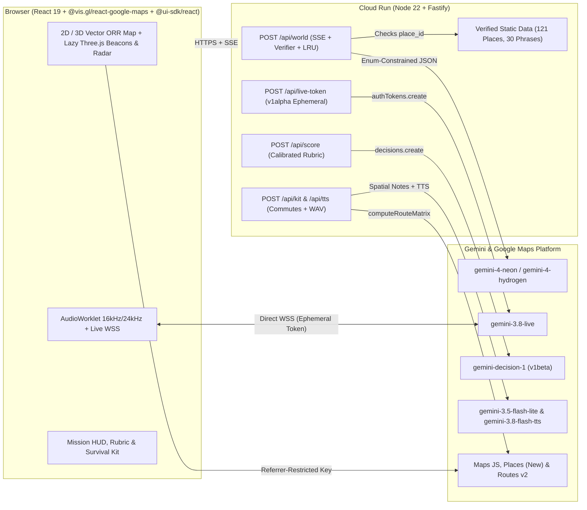

# Architecture Overview

**Apna Area** is a single-container TypeScript application on Google Cloud Run (`asia-south1`) that turns Bengaluru's eastern Outer Ring Road (Marathahalli to Silk Board) into a playable first-week rehearsal for newcomers.

## Runtime Flow and Verification

1. **Deterministic Geography & 3D Dusk Layer:** At build time, `scripts/verify-places.ts` and `scripts/build-corridor.ts` query Places API (New) and Routes API v2 to freeze `121` operational corridor places (`data/orr/places.json`) and a `545`-point route polyline (`corridor.geojson`). Hardware-accelerated desktop GPUs unlock an opt-in `RenderingType.VECTOR` 3D Dusk mode (`65deg` Sky-Drop camera, `RadarMinimap`, and lazy-loaded Three.js `WebGLOverlayView` beacons and traffic streaks, keeping initial 2D JS `< 195 KB` gzipped). No database is used; player state stays in `localStorage`.
2. **Double-Locked Planning (`gemini-4-neon`):** When a player picks an office, `POST /api/world` selects nearby verified candidates within 3 km, constrains `placeId` via a dynamic JSON Schema `enum`, and runs `verifyWeekPlan` before streaming SSE completion. Transient 429/503s and verifier misses retry once, fall back to `gemini-4-hydrogen` (`thinking_level: "low"`), and finally serve a labelled real replay.
3. **Low-Latency Voice (`gemini-3.8-live`):** `POST /api/live-token` mints a server-locked `v1alpha` ephemeral token (`uses: 3`, 90-second cap) with `NON_BLOCKING` tools (`give_hint`, `mark_phrase_attempt`, `complete_objective`). Audio streams directly between browser and Gemini without storing voice or exposing `GEMINI_API_KEY`.
4. **Calibrated Routing (`gemini-decision-1`):** `POST /api/score` evaluates 5 rubric questions in ~450 ms with zero output tokens, clamping `< 0.75` confidence to steady difficulty while offering 1-click player overrides.
5. **Grounded Survival Kit:** `POST /api/kit` pre-warms Monday `09:00` and `18:30` IST `computeRouteMatrix` durations, `gemini-3.5-flash-lite` price-free spatial notes, and cached `gemini-3.8-flash-tts` Kannada WAV clips. Every external link or PNG download requires an explicit `@ui-sdk/react` `ConfirmSheet`.
