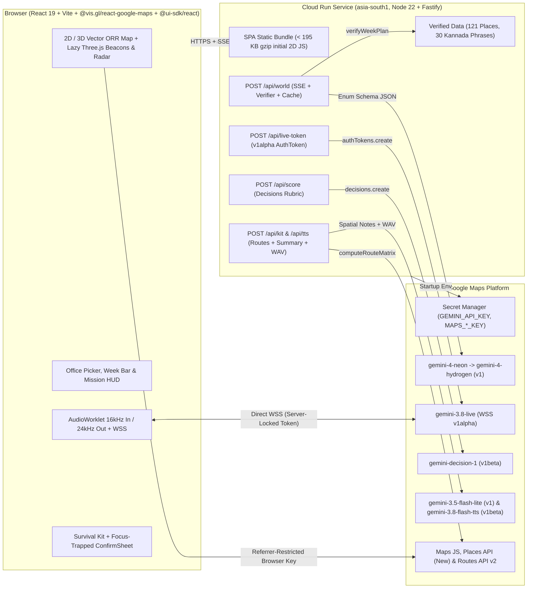

# Build History and Deep Dives

Material moved out of the root README so the front page stays short. Nothing here is required to run the app.

## Phases, branches and tags

Every milestone shipped on an isolated `phase/<step>` branch, passed automated tests, independent code review, and Cloud Run `--no-traffic` preview smoke tests, then landed on `main` via `--no-ff` merge and git tag:

- [`v0.1-docs`](https://github.com/bhagyarana/Apna-Area/releases/tag/v0.1-docs) · Living specs, Carbon adversarial review, and seeded `ORR Neon Dusk` design discovery
- [`p0-skeleton`](https://github.com/bhagyarana/Apna-Area/releases/tag/p0-skeleton) · Monorepo workspaces, structured logger, `/api/health`, Docker image, and first Cloud Run deploy
- [`p1-map`](https://github.com/bhagyarana/Apna-Area/releases/tag/p1-map) · Verified `121`-place ORR dataset, `545`-point corridor spline, skippable tour, and `@ui-sdk/react` picker
- [`p2-director`](https://github.com/bhagyarana/Apna-Area/releases/tag/p2-director) · `gemini-4-neon` SSE Week One Director, `verifyWeekPlan`, Hydrogen/replay fallback ladder, and provenance HUD
- [`p3a-english`](https://github.com/bhagyarana/Apna-Area/releases/tag/p3a-english) · `gemini-3.8-live` `v1alpha` ephemeral voice pipeline, AudioWorklet PCM resampler, and Nano Banana portraits
- [`p3b-hindi`](https://github.com/bhagyarana/Apna-Area/releases/tag/p3b-hindi) · Hindi and Hinglish code-switching behind `ENABLED_LANGUAGES`
- [`p3c-kannada`](https://github.com/bhagyarana/Apna-Area/releases/tag/p3c-kannada) · `30` polite Kannada survival phrases, WebAudio mastery chime, and `PhraseFlyCard` animation
- [`p4-adaptive`](https://github.com/bhagyarana/Apna-Area/releases/tag/p4-adaptive) · `gemini-decision-1` `v1beta` rubric scoring, rolling XP odometer, and 1-click player pace overrides
- [`p5-kit`](https://github.com/bhagyarana/Apna-Area/releases/tag/p5-kit) · Pre-warmed Google Routes API `computeRouteMatrix`, `gemini-3.8-flash-tts` replay, Lyria 3 mood loops, and `ConfirmSheet`
- [`p6-demo-ready`](https://github.com/bhagyarana/Apna-Area/releases/tag/p6-demo-ready) · 2nd Carbon adversarial audit fixes, `< 190 KB` gzip initial JS, subtraction/a11y polish (`9.4/10` independent critic score), `?demo=1` timer, and 3 sub-3-minute live rehearsals
- [`p7-submission`](https://github.com/bhagyarana/Apna-Area/releases/tag/p7-submission) · Judge submission pack, architecture overview, video coverage checklist, and full-history secret scan
- [`p8-3d-dusk`](https://github.com/bhagyarana/Apna-Area/releases/tag/p8-3d-dusk) · Hardware-gated 3D Neon Dusk open-world mode (`RenderingType.VECTOR` `65deg` Sky-Drop + lazy Three.js `WebGLOverlayView` volumetric beacons & `545`-point bi-directional ORR traffic + heading-locked `RadarMinimap`)

**Agent orchestration:** Built in Google Antigravity combining **Gemini 4 Carbon** (architecture, linguistic phrase review, fresh-context adversarial audits, code review gates, and blind screenshot-only design critiques across 3 rounds per UI phase), **Gemini 4 Neon** (phase orchestration and multi-model integration), and **Gemini 4 Hydrogen** (focused parallel implementation tickets).

## Sequential Language Rollout (`ENABLED_LANGUAGES`)

Voice languages shipped one at a time on dedicated branches and git tags behind `ENABLED_LANGUAGES` in [`shared/src/config.ts`](shared/src/config.ts):
1. **English (`p3a-english`):** Full `16 kHz` AudioWorklet capture, `24 kHz` gapless PCM playback, captions, and docked keyboard fallback across all 5 ORR NPC roles (`632-823 ms` first-audio latency).
2. **Hindi & Hinglish (`p3b-hindi`):** `Noto Sans Devanagari` rendering, `Tune · EN / HI / HI+EN` comfort selector, and natural mid-turn Hindi/English code-switching (`529-765 ms` turn latency).
3. **Kannada Survival Phrases (`p3c-kannada`):** `30` linguistically audited, polite-plural (`ಕೊಡಿ` *koḍi*, `ಬನ್ನಿ` *banni*, `ಹೇಳಿ` *hēḷi*), gender-honorific-matched (`ಅಣ್ಣ` *aṇṇa* / `ಅಕ್ಕ` *akka*) survival phrases in [`data/phrases.json`](data/phrases.json) with `Noto Sans Kannada` captions and mastery card flight.

## Runtime & Build-Time Model Routing (`shared/src/config.ts`)

All model identifiers live exclusively in [`shared/src/config.ts`](shared/src/config.ts):

| Job | Model ID | API Surface | Why This Model Was Chosen |
|---|---|---|---|
| **Week One Director & NPC Briefs** | `gemini-4-neon` (`thinking_level: "medium"`) | `interactions.create` (`v1`) | Plans 5 spatially grounded, non-repeating missions across verified candidate `place_id`s while the player watches honest SSE steps. |
| **Director Verification / 503 Fallback** | `gemini-4-hydrogen` (`thinking_level: "low"`) | `interactions.create` (`v1`) | Fast low-thinking workhorse fallback before serving a labelled real earlier run (`Replayed from an earlier run`). |
| **Real-Time Multilingual Voice NPCs** | `gemini-3.8-live` | `authTokens.create` + `live.connect` (`v1alpha`) | Sub-second two-way spoken English, Hindi, Hinglish, and Kannada coaching with barge-in interruption and `NON_BLOCKING` tool calls. |
| **Rubric Scoring & Adaptive Routing** | `gemini-decision-1` | `decisions.create` (`v1beta`) | Evaluates 5 parallel `noul`, `score`, and `choice` questions in ~450 ms with `0` output tokens and calibrated confidence. |
| **Spatial Corridor One-Liners** | `gemini-3.5-flash-lite` (`thinking_level: "minimal"`) | `interactions.create` (`v1`) | Fast, low-cost spatial neighbourhood notes verified free of price claims and chart-number repetition. |
| **Kannada Phrasebook Audio Replay** | `gemini-3.8-flash-tts` (`Sulafat`) | `interactions.create` (`v1beta`) | Clear, learner-paced `24 kHz` WAV pronunciation cached in memory by curated `phraseId`. |
| **Ambient Mood Soundtrack (Build-Time)** | `lyria-3-clip-preview` | `interactions.create` (`v1beta`) | Generates 4 seamless 30-second instrumental MP3 loops (`calm`, `morning`, `rush`, `evening`) once at build time (`$0` per visitor). |
| **Fictional NPC Portraits (Build-Time)** | `gemini-nano-banana-2.1` | `interactions.create` (`v1`) | Generates 10 gender-matched `256x256` WebP portraits (`<role>_<gender>.webp`) once at build time (`$0` per visitor). |

## How Apna Area Passes the Four Judge Tests

| Judge Test | How Apna Area Proves It Live |
|---|---|
| **1. Concrete problem for a named person** | Designed end-to-end around **Ananya** (24, moving from Lucknow to a Bellandur tech park in 14 days). Every screen answers one of her real first-week anxieties: auto meter negotiation, darshini counter ordering, PG backup power/water checks, BMTC feeder stops, and weekday ORR commutes. |
| **2. Needs Gemini 4 reasoning, routing, and verification** | `gemini-4-neon` plans a coherent 5-day mission graph constrained to a dynamic JSON Schema `enum` of verified `place_id`s within 3 km, backed by a deterministic server verifier (`verifyWeekPlan`). `gemini-decision-1` scores transcripts in ~450 ms (`0` output tokens) with calibrated probabilities and `< 0.75` confidence clamping. `gemini-3.8-live` runs real-time trilingual NPCs with `NON_BLOCKING` tools. |
| **3. People stay in control** | Every external link (`Google Maps` directions) and local export (`apna-area-survival-kit.png`) is gated behind a focus-trapped `@ui-sdk/react` `ConfirmSheet` with `Esc`/`Cancel` focus restoration. Players can override AI difficulty routing in one click (`Switch to gentler pace` / `Step up Kannada`). No geolocation, no bookings, no payments, and zero stored voice or transcripts. |
| **4. Live, real input, under 3 minutes** | Judges pick any of the 12 verified eastern ORR tech parks live. World generation, bidirectional voice dialogue, calibrated scoring, pre-warmed Routes API commute bars, and phrase TTS replay finish comfortably inside 2 minutes 35 seconds. |

## Full architecture diagram

